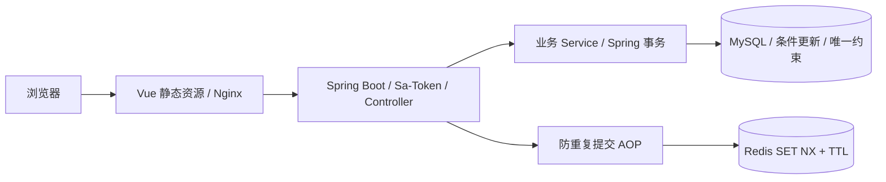

# 企业运营管理系统

企业运营管理系统采用前后端分离架构，支持企业日常运营中的人员管理、采购、销售、退货与库存业务，并提供角色和部门权限、审批、消息通知及数据统计。本项目在原有系统基础上，重点完善并发数据一致性、员工接口、防重复提交和容器化部署。

## 来源与作者归属

原项目：[shanqiu127 / Collaborative-Operation-Management-System](https://github.com/shanqiu127/Collaborative-Operation-Management-System)。本项目已获得原作者二次开发及公开发布许可，保留原作者归属。详见 [NOTICE](NOTICE.md)。

**原项目已有**：认证与角色/部门权限、用户和部门管理、采购/销售/退货、库存、供应商和商品、统计页面、公告消息、工作要求、审批与 AI 助手相关代码。本次个人二次开发集中于以下四个方向。

## 四项二次开发

| 方向 | 实际改造与证据 |
| --- | --- |
| 库存并发与事务一致性 | 保留条件更新防超卖；来源单据行锁串行化退货额度检查；条件状态更新防止重复删除变更库存；库存流水与业务同事务，唯一索引限制重复事件；真实 MySQL 并发/回滚验证 |
| 员工数据库与 API | 查询与显式历史修补分离；UNION ALL 合并普通员工和只读管理员并在数据库分页；Bean Validation；逻辑删除兼容的手机号唯一索引；跨表回滚及真实 Sa-Token 角色/部门授权验证 |
| Redis 防重复提交 | 在原 AOP + SET NX/TTL 实现上优化 SHA-256 指纹、用户/接口/参数隔离及有界本地降级；真实 Redis 并发、断连恢复及 MySQL 联合故障测试 |
| Docker 与 CI 配置 | Vue/Nginx、Java17、MySQL、Redis 四服务 Compose；健康依赖、强密码管理员初始化、持久化卷；真实容器登录/库存业务与重启验证；GitHub Actions 构建测试工作流 |

阅读：[库存验收](docs/stock-acceptance.md) · [员工验收](docs/employee-api-acceptance.md) · [Redis验收](docs/redis-acceptance.md) · [部署验收](docs/deployment-acceptance.md)。

## 技术栈与架构

Java 17、Spring Boot 3.3.5、MyBatis-Plus 3.5.5、MySQL 8、Redis、Sa-Token、Bean Validation、JUnit 5、Maven；Vue 3、Vite、Element Plus、Axios；Docker Compose、Nginx、GitHub Actions。



MySQL 是业务一致性的边界；Redis 短时间防重不等于持久业务幂等。本地降级不能保证多实例统一防重，切换窗口的限制详见 Redis 报告。

## 核心功能

- 用户登录与角色、部门权限管理。
- 员工档案、用户账号及部门管理。
- 供应商、商品资料、采购入库与采购退货。
- 销售出库、销售退货、库存管理与预警。
- 数据统计、审批处理、公告及消息通知。

## Docker 快速运行

需要可运行 Linux 容器的 Docker Engine 与 Docker Compose。无需连接已有业务数据库。

1. 将 `.env.example` 复制为本地 `.env`（已有文件不要覆盖）。
2. 先填写本地应用数据库用户名 `DB_USERNAME`，再填写三个**各不相同、随机生成**的强密码：`MYSQL_ROOT_PASSWORD`、`DB_PASSWORD`、`ADMIN_INITIAL_PASSWORD`。管理员密码16–64位，含字母和数字。不要提交或分享 `.env`。
3. 运行：

```bash
docker compose -p ecs-portfolio up --build -d --wait
docker compose -p ecs-portfolio ps
```

4. 浏览 `http://localhost:18080`，账号 `superadmin`，密码为自己填写的 `ADMIN_INITIAL_PASSWORD`。没有公开固定初始密码。

数据库和 Redis 不发布主机端口；前端只绑定本机回环。数据库与上传目录使用命名卷。首次空卷运行结构及最小合成种子数据；管理员初始处于禁用状态，启动时用环境变量生成 BCrypt 密码。重启不会重置已有密码。

初始化仅包含必要的合成示例数据。管理员新增账号使用不可预测的随机初始值，由有权限管理员通过已有“设置密码”功能设置后再交付使用。

```bash
docker compose -p ecs-portfolio logs --tail 100 backend
docker compose -p ecs-portfolio restart
```

不要用 `down -v` 排错。`db.sql` 仅用于全新数据库，不可对已有业务库执行；增量迁移见 [docs/migrations](docs/migrations)，执行前自行备份并审查历史冲突。专用 Nginx 网段为 `172.30.94.0/24`，若冲突，需同步修改 Compose 和 `deploy/003-container-login.sql`。此配置仅供本机展示，未完成公网 TLS 与生产安全部署。

## 测试与验证

此前限定范围统一回归：**42 项通过，失败0、错误0、跳过0**（库存16、员工17、Redis7、容器初始化2）。覆盖本次二次开发相关模块。安全摘要：[JUnit汇总](docs/verification/deployment/junit-summary.json)。

[发布整理报告](docs/publication-safety.md) 单独记录发布副本重新验证结果，不能以原副本的结果代替清理后的验证。

集成测试必须显式设置 `PURCHASE_TEST_JDBC_URL`、`PURCHASE_TEST_USERNAME`、`PURCHASE_TEST_PASSWORD`，仅允许本机专用 `warehouse_management_integration_test` 数据库；Redis 使用独立测试实例，`REDIS_TEST_SERVER` 指向可执行文件。禁止使用正式数据库/Redis。

测试集合、运行条件及验证范围见四份验收报告。

[GitHub Actions](.github/workflows/verify.yml) 已配置 Java17、临时 MySQL/Redis、指定 JUnit 集合、Vue 构建和两个镜像构建。最新远程运行结果以仓库 Actions 页面为准。

## 使用说明

默认部署面向本机演示，管理员密码由环境变量初始化。生产部署需另行配置 HTTPS、备份和访问策略；依赖安全状态见 [依赖安全复核](docs/dependency-security.md)，测试边界见验收报告。AI 助手为可选模块，不影响主要业务运行。
